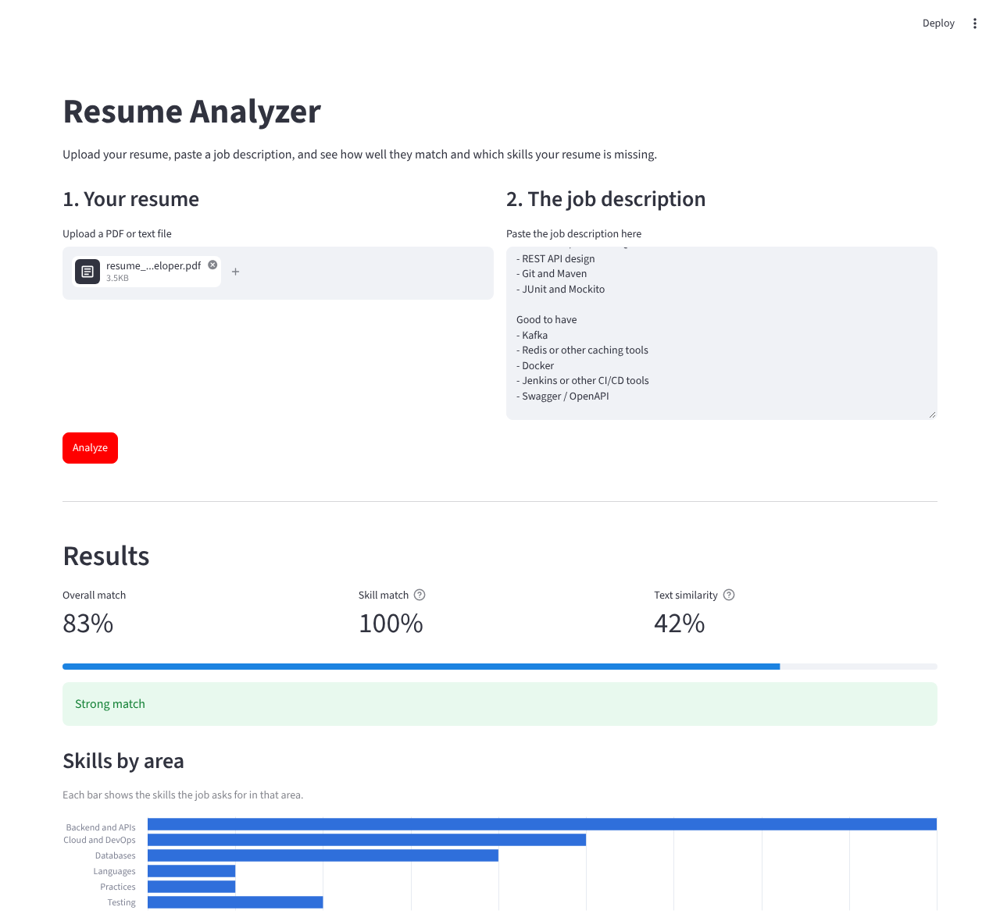
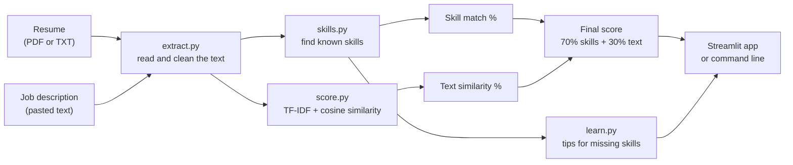
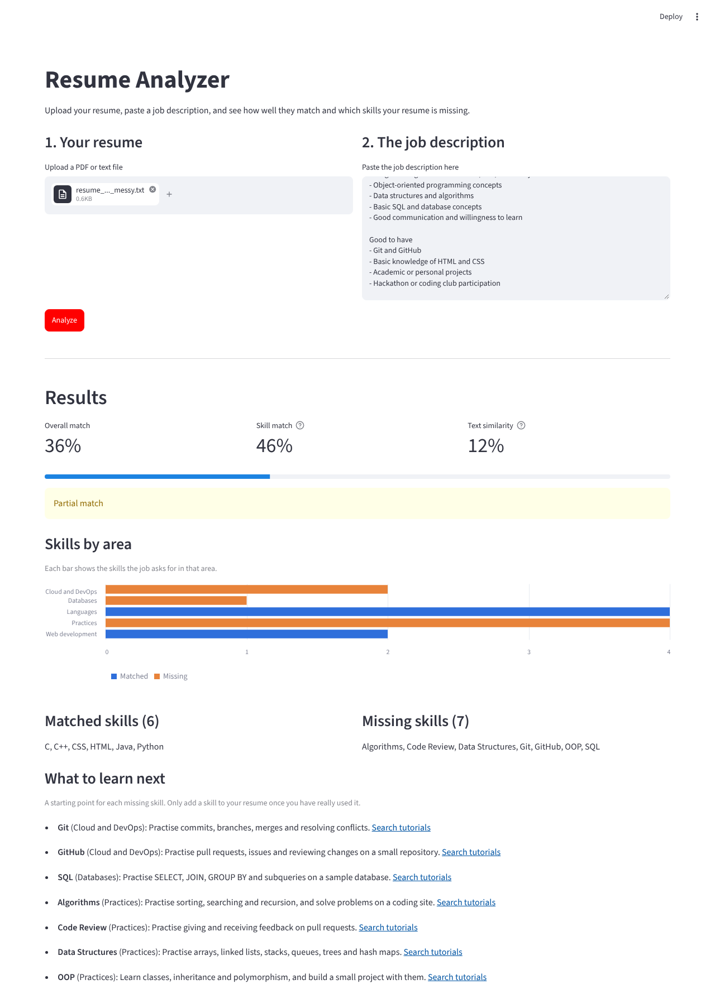

# Resume Analyzer

A Python tool that compares a resume with a job description. It shows how well they match, which skills the resume already covers, which skills are missing, and what to learn next.

Built for the **Industry Readiness** subject.



## Problem statement

Job seekers, especially freshers, often do not know whether their resume fits a job, or which skills they should learn to fit it better. Reading every job description by hand and comparing it with the resume is slow and easy to get wrong.

This project automates that comparison. The user uploads a resume and pastes a job description, and the program returns a match score, the skills that match, the skills that are missing, and a short learning tip for each missing skill.

## Features

- Reads resumes from **PDF** or **TXT** files (including TXT files saved by Windows Notepad).
- Finds **157 skills** (languages, frameworks, databases, cloud tools, design and marketing tools, and more) in both texts, including common spellings such as `node js`, `k8s` or `powerbi`.
- Gives an **overall match score** from 0 to 100% with a rating: Strong, Good, Partial or Weak.
- Shows a **chart of skills by area**, so you can see where the gaps are.
- Lists **matched and missing skills**, and a **learning tip with a tutorial search link** for every missing skill.
- Has a **web app** (Streamlit) and a **command-line version** that ranks every job in `data/jobs` for one resume.
- Shows clear messages instead of crashing when a file is empty, unreadable, or a scanned image.
- Covered by **104 automated tests**.

## How it works



1. **Extract and clean.** `pdfplumber` reads the text of a PDF. The text is lowercased and cleaned, but `+`, `#` and `.` are kept so that `C++`, `C#` and `Node.js` survive.
2. **Find skills.** Each skill in `data/skills.json` has a name and a list of aliases. A regular expression with word boundaries finds them, so `Java` does not match inside `JavaScript`.
3. **Skill match.** The share of the job's skills that also appear in the resume.
4. **Text similarity.** scikit-learn turns both texts into TF-IDF vectors, and cosine similarity measures how alike the wording is.
5. **Final score.**

   ```
   final score = 0.7 × skill match + 0.3 × text similarity
   ```

   Skills count more because they are the clearest signal. The text similarity catches the wording around them.

| Final score | Rating |
|---|---|
| 75% and above | Strong match |
| 50% to 74% | Good match |
| 25% to 49% | Partial match |
| Below 25% | Weak match |

The score is **directional**: it answers "how much of this job does the resume cover?". Swapping the resume and the job gives a different number.

## Example results

All sample resumes and jobs in `data/` are fictional.

| Resume | Job | Score | Skill match | Text similarity | Rating |
|---|---|---|---|---|---|
| Java developer | Java backend engineer | 83% | 100% | 42% | Strong match |
| Fresher (messy resume) | Software engineer trainee | 36% | 46% | 12% | Partial match |
| Java developer | Embedded firmware engineer | 7% | 8% | 4% | Weak match |

For the fresher, the app lists the 7 missing skills (Git, GitHub, SQL, Algorithms, Code Review, Data Structures, OOP) and a tip for each:



## Setup

You need Python 3.10 or newer.

```bash
git clone https://github.com/Omkardhal/resume-analyzer.git
cd resume-analyzer

python3 -m venv venv
source venv/bin/activate        # Windows: venv\Scripts\activate

pip install -r requirements.txt
```

## Usage

### Web app

```bash
streamlit run app.py
```

Open the address Streamlit prints (usually http://localhost:8501), upload a resume, paste a job description, and click **Analyze**.

### Command line

Compare one resume with one job:

```bash
python cli.py data/resumes/resume_java_developer.pdf data/jobs/job_java_backend_engineer.txt
```

Rank every job in `data/jobs` for one resume:

```bash
python cli.py data/resumes/resume_java_developer.pdf
```

## Tests

```bash
python -m pytest
```

The tests cover text extraction (PDF, UTF-8, UTF-16 and old Windows files), skill matching, scoring, learning tips, the command line, and the Streamlit app itself. One test checks that every sample resume ranks its own job first.

## Project structure

```
resume-analyzer/
├── app.py                  Streamlit web app
├── cli.py                  command-line version
├── requirements.txt
├── pytest.ini
├── src/
│   ├── extract.py          read PDF/TXT files and clean the text
│   ├── skills.py           find skills in text
│   ├── score.py            skill match, TF-IDF similarity, final score
│   └── learn.py            learning tips and chart data
├── data/
│   ├── skills.json         157 skills and their aliases
│   ├── learning.json       area and learning tip for each skill
│   ├── resumes/            sample resumes (fictional)
│   └── jobs/               sample job descriptions (fictional)
├── tests/                  automated tests
└── docs/                   screenshots used in this README
```

## Limitations

- **Keywords, not meaning.** The program finds skill words, but it does not understand context. "Worked with React developers" counts as knowing React.
- **Only known skills.** A skill that is not in `data/skills.json` is ignored. New skills can be added to that file without changing any code.
- **Text-based PDFs only.** A scanned resume (a picture of a page) has no text to read, and the app says so.
- **Two-column layouts.** PDFs with two columns can have their lines mixed together, which lowers the text similarity.
- **A guide, not a verdict.** The score shows how well the wording matches. It does not judge experience or how good the candidate is.

## Future improvements

- Read skills from the context of a sentence, for example with a language model, instead of keywords.
- Support scanned resumes with OCR.
- Compare one resume with many pasted jobs at once in the web app.
- Suggest wording improvements, not just missing skills.

## Built with

Python, Streamlit, pdfplumber, scikit-learn, pandas, pytest.
